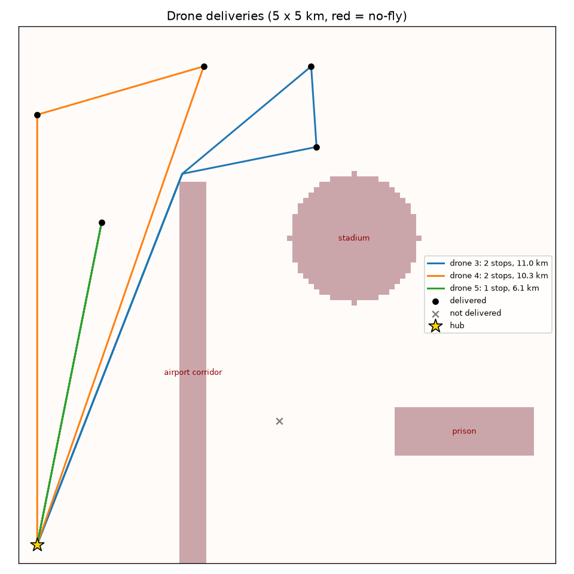

# Crane + drone delivery planner

Plans container crane moves to balance, unload, and load a ship in minimum crane time, then
routes a drone fleet to deliver the unloaded packages.

The project started as the CS 179M senior project at UC Riverside (Winter 2022, team of 3,
original repo: [luccavp12/CS179m](https://github.com/luccavp12/CS179m)). That version is a
Flask web app with a greedy balancer (`balance.py`, `operations.py`, `hello.py`). It is kept
here unchanged except for an import guard.

The 2026 extension (`planner/`) replaces the greedy with an A* search, benchmarks the two
against each other, and adds drone delivery routing.



`python -m planner.demo JSONs/shipCase3.json --seed 1` unloads 3 containers with the crane
planner, splits them into packages with drop-offs around a 5 km x 5 km city, routes 6 drones
around the no-fly zones, and staggers takeoffs so no two drones come within 150 m of each
other. Full output: [docs/demo_output.txt](docs/demo_output.txt).

## How it works

- **State** (`planner/ship.py`): 12 columns x 8 levels, each column a stack of
  `(weight, name)`. Unusable (`NAN`) cells are treated as fixed obstacles. The state is
  hashable, so the search can remember which states it has already seen.
- **Moves:** lift the top container of a column and set it on another column that has room,
  or hand it to or from the truck at the dock.
- **Cost:** crane minutes. The crane goes up, across, and down, clearing every stack in
  between by one level. Empty travel to the next pickup counts, plus 2 minutes per truck
  handoff.
- **Balanced:** the lighter side weighs at least 90% of the heavier side (`BALANCE_RATIO`).
- **Search** (`planner/crane.py`): one A* function with a different goal and heuristic per
  job:
  - *Balance:* some container now on the heavy side must cross the centerline, so the plan
    costs at least the horizontal distance from the nearest occupied heavy-side column.
  - *SIFT* (when no split of the weights can balance): heaviest containers nearest the
    center. Every container above the first misplaced cell in its column must be lifted
    and carried at least to the nearest column where its weight belongs.
  - *Unload/load:* every unload must reach the dock and every load must leave it, plus the
    truck handoff.

  None of the heuristics ever overestimates. The tests check this by comparing A* against
  uniform-cost search, which must give the same plan cost.
- **Weighted A\*** (`weight=2`) multiplies the heuristic by 2. The plan is then guaranteed
  to cost at most 2x the optimum. On 3-container unload jobs from case 3 it found the
  optimal plan in 0.3-1.2 s, against 39-118 s for exact A*. The demo uses it. Exact A*
  still can't empty a whole 6-container ship within its 500,000-state limit. The unload
  heuristic undercounts vertical travel, since a container could be stacked higher before
  it is unloaded.

## Results

`python bench.py` runs the original greedy and the A* planner on the five test manifests,
scoring both with the same crane-time model:

| Case | Greedy moves | Greedy min | A* moves | A* min | A* runtime | Notes |
|---|---|---|---|---|---|---|
| 1 | 1 | 15 | 1 | 15 | 1 ms | same plan |
| 2 | 2 | 22 | 2 | 22 | 65 ms | same plan |
| 3 | 2 | 25 | 2 | 25 | 144 ms | same plan |
| 4 | 6 | 57 | 4 | 43 | 132 ms | A* 25% less crane time: greedy stacks blockers onto a column, then has to move them off again |
| 5 | 10 | invalid | 5 | 43 | 6.6 s | can't be balanced (one box weighs 96 of 113 total). Greedy's 2nd move lifts the cell it just emptied. A* plans the SIFT layout. |

The greedy's own minute count (4, 6, 8, 26, 28) leaves out empty crane travel and the climb
over stacks, so the table rescores its moves with the same model as A*.

## Drone delivery routing (`planner/drone.py`)

- **Paths:** 8-connected A* on a grid of 50 m cells, around no-fly zones (rectangles and
  circles). The heuristic is octile distance, the exact cost on an empty grid, so it never
  overestimates. Diagonal steps can't cut the corner of a no-fly cell.
- **Smoothing:** from each waypoint, jump to the farthest later waypoint with a clear straight
  line. The line check is an exact grid traversal (Amanatides-Woo) in integer arithmetic.
  Shortcuts never make a path longer.
- **Fleet:** Google OR-Tools vehicle routing over the smoothed path lengths, with payload
  capacity, battery range per sortie, delivery time windows, and drop penalties so
  packages that can't be delivered are reported with a reason (over payload, out of range,
  or no drone/time slot) instead of making the solve fail. Airtime is charged per second,
  so a drone with a late delivery slot waits on the pad instead of hovering.
- **Separation:** samples every drone's position each second and flags pairs closer than
  150 m, ignoring the area right around the hub. `deconflict` then delays departures in
  15 s steps until no conflicts remain, as long as every delivery stays in its window.

On a 5 km x 5 km map with 3 no-fly zones, 15 packages and 6 drones: planning takes 2.9 s
(2 s is the OR-Tools search limit). All 6 drones leaving at t=0 caused 6 separation
conflicts on the way out of the hub; staggering departures 15-45 s cleared all of them.

### C++ extension (`cpp/fastgrid.cpp`)

The grid A* and line-of-sight smoothing are also written in C++17, exposed to Python with
pybind11 as `planner._fastgrid`. `drone.py` uses it when it is built and falls back to the
pure-Python version otherwise. Both use the same tie-breaking (smallest `(f, x, y)` first,
same neighbor order), so they return identical paths. A test checks this on 20 random maps,
and `bench.py` checks it on every benchmark run.

| 1000 x 1000 grid, 10 paths | Total | Per path |
|---|---|---|
| Python | 7.0-7.9 s | ~700-790 ms |
| C++ | 0.13 s | ~13 ms |

About 50x faster (50-60x across 3 runs).

Simplifications: one sortie per drone per wave (no multi-trip), and a flat 2D map (no
altitude layers or wind).

## Run

```
python -m venv .venv
.venv\Scripts\activate          # Linux/macOS: source .venv/bin/activate
pip install -r requirements.txt
pytest -q
python bench.py
python -m planner.demo JSONs/shipCase3.json --seed 1
```

Optional C++ extension:

```
pip install pybind11
python setup.py build_ext --inplace     # any C++17 compiler (g++, clang, MSVC)
# Windows without the Windows SDK: pip install ziglang && python cpp/build_zig.py
```

Tested on Python 3.14 with OR-Tools 9.15 (Windows, extension built with Zig's clang).
